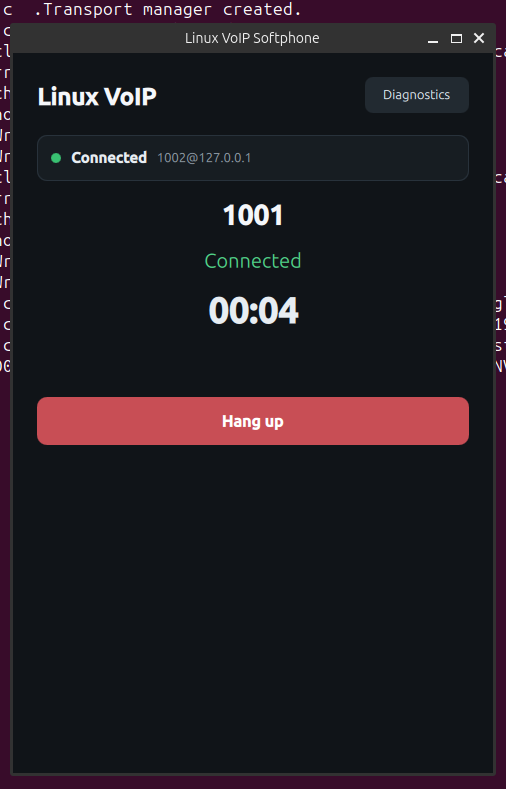
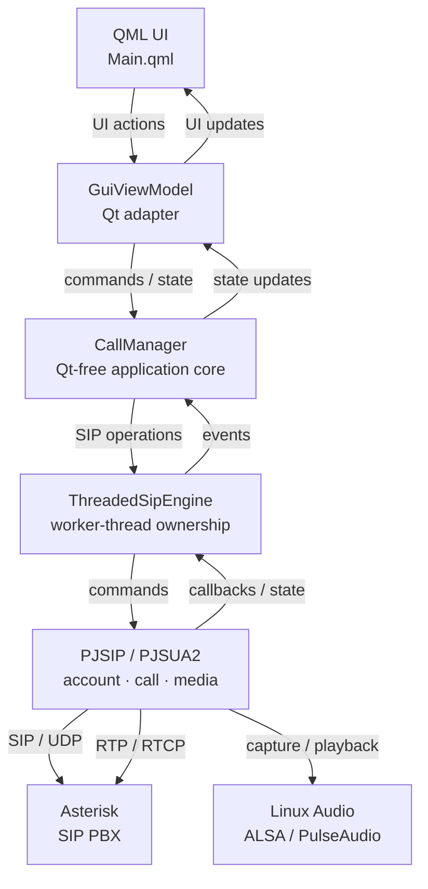

# Linux VoIP Softphone

[](https://github.com/haikevins/linux-voip-softphone/actions/workflows/build.yml)
[](https://github.com/haikevins/linux-voip-softphone/actions/workflows/test.yml)
[](https://github.com/haikevins/linux-voip-softphone/actions/workflows/static-analysis.yml)

[](https://github.com/haikevins/linux-voip-softphone/releases/tag/v1.0.0)

A C++20/Linux engineering project that builds a SIP softphone from networking
and SIP fundamentals through PJSUA2 integration, RTP/audio, a Qt/QML desktop
interface, multithreading and lifetime analysis, diagnostics, and an RTSP/RTP
mini-lab.

The project is developed as a sequence of independently verified engineering
milestones and is released as **v1.0.0**.

**Release:** [v1.0.0](https://github.com/haikevins/linux-voip-softphone/releases/tag/v1.0.0)<br>
**Platform:** Linux<br>
**Core stack:** C++20 · CMake · PJSIP/PJSUA2 2.17 · Qt 6/QML · GoogleTest

<p align="center">
  
</p>

## Highlights

- SIP registration plus outgoing and incoming call lifecycles using PJSUA2.
- Real Linux capture/playback with bidirectional RTP audio and RTP/RTCP diagnostics.
- Qt 6/QML desktop UI separated from application and SIP/media ownership.
- Explicit thread ownership, callback handoff, shutdown, and lifetime verification.
- Sanitizer, clang-tidy, regression, integration, and packaged-artifact acceptance gates.
- RTSP/SDP/RTP mini-lab covering protocol parsing, session control, UDP media reception, and end-to-end verification.

## Architecture



The detailed system boundaries, runtime lifecycle, release architecture, and
verification strategy are documented in
[`docs/architecture/system-overview.md`](docs/architecture/system-overview.md).

## Quick build

The full release build enables both Qt and PJSIP.

Prerequisites include a C++20 compiler, CMake/Ninja, Qt 6, and
PJPROJECT/PJSIP 2.17.

```bash
export PKG_CONFIG_PATH="$HOME/.local/pjproject-2.17/lib/pkgconfig${PKG_CONFIG_PATH:+:$PKG_CONFIG_PATH}"

cmake --preset release
cmake --build --preset release -j"$(nproc)"
```

To exercise the complete reproducible packaging path:

```bash
./scripts/phase11/verify-package.sh
```

This produces the Linux TGZ release package containing:

```text
linux-voip-softphone
linux-voip-softphone-gui
rtsp-lab
voip-sip-register
voip-sip-call
voip-sip-listen
```

For dependency setup and other build configurations, see the phase and
architecture documentation under [`docs/`](docs/).

## Quick demo

For a guided 10–15 minute project walkthrough:

**[`docs/phase11/demo-guide.md`](docs/phase11/demo-guide.md)**

A useful demo path is:

```text
build / verification
        ↓
SIP registration
        ↓
outgoing or incoming call
        ↓
two-way RTP audio
        ↓
live RTP diagnostics
        ↓
clean hangup
        ↓
RTSP / SDP / RTP mini-lab
```

The GUI and SIP runtime are intended for a controlled Linux/Asterisk lab.
Credentials and other sensitive SIP material are supplied only at runtime and
are not stored in repository evidence.

## Verification

Build, tests, sanitizers, static analysis, and release acceptance are automated
through the repository CI and verification scripts.

**[Verification evidence → `evidence/`](evidence/)**

## Engineering scope

| Area | What is exercised |
| --- | --- |
| Modern C++ | RAII, ownership, value semantics, interfaces |
| Linux systems | processes, signals, file descriptors, IPC |
| Networking | IPv4, TCP, UDP, socket integration |
| SIP | REGISTER, INVITE, dialog and call lifecycle |
| PJSIP/PJSUA2 | real SIP endpoint and account/call integration |
| RTP/audio | Linux devices, media bridging, RTP/RTCP diagnostics |
| Qt/QML | desktop presentation with controlled backend ownership |
| Concurrency | queues, worker ownership, callback/thread handoff |
| Diagnostics | crash analysis, sanitizers, regression verification |
| RTSP | RTSP parsing, SDP, session workflow, RTP/AVP reception |
| Release engineering | reproducible build, install, package, acceptance |

## Repository layout

```text
.
├── src/          production C++ implementation
├── tests/        unit and integration tests
├── labs/         focused learning/engineering experiments
├── tools/        diagnostic utilities
├── docs/         architecture, protocol, phase, and interview documentation
├── evidence/     sanitized verification evidence
├── scripts/      build, quality, verification, and release automation
└── cmake/        shared CMake configuration
```

## Releases

The current engineering release is:

**[Linux VoIP Softphone v1.0.0](https://github.com/haikevins/linux-voip-softphone/releases/tag/v1.0.0)**

The release contains a packaged Linux binary archive and `SHA256SUMS` for
integrity verification.

The TGZ is a Linux binary package, not a fully self-contained application
bundle. Compatible host runtime dependencies such as Qt and PJSIP are still
required where applicable.

## Documentation

Recommended entry points:

- [Final release and operational guide](docs/phase11/README.md)
- [System architecture](docs/architecture/system-overview.md)
- [Demo guide](docs/phase11/demo-guide.md)
- [Architecture documentation](docs/architecture/)
- [Protocol notes](docs/protocols/)
- [Interview review material](docs/interview/)
- [Verification evidence](evidence/)
- [Project roadmap](ROADMAP.md)

## Project philosophy

This repository is an engineering portfolio rather than a claim of a
production-ready commercial softphone.

The focus is on understanding and demonstrating the boundaries between Linux
systems programming, networking, SIP signaling, RTP media, GUI/application
ownership, concurrency, debugging, testing, and release engineering.

## License

See [`LICENSE`](LICENSE) for the repository license.
